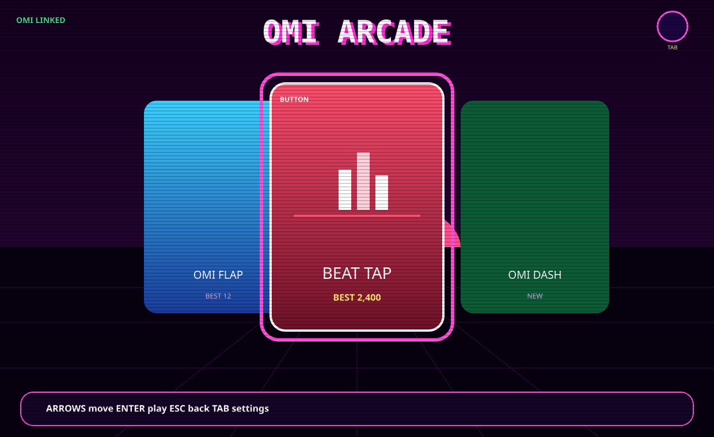

# Sideband

**A game console that lives on your Mac.** Large cover cards, the focused one lifted with a soft glow, and the background taken from that game. Keyboard and mouse first. An [Omi](https://github.com/BasedHardware/omi) pendant is a controller when you want one. An Xbox, PlayStation or generic gamepad is too. Nothing is uploaded. There is no account.



The picture above is drawn in the repo (no network, no screenshot tool). Drop a real capture on top of it at `docs/screenshots/home.gif` when you have the app open.

| | | |
|---|---|---|
| 🕹 | **The shelf** | The window that opens. Cover art, a details strip under the focused card. Arrow keys or the scroll wheel move. Enter plays. Esc goes back. Hover a card, click it to play. |
| 🎚 | **One-button games** | Beat Tap, Quickdraw, Omi Dash, Simon Omi. Stock pendant firmware is enough: tap, double tap, hold, or a shout. |
| ✈️ | **Desert 91 and the 3D games** | The flagship is a 1991 desert in a real 3D window: WASD, mouse look, click to fire. Sky Ace 1943, Star Dodger and Corn Maze use the same window. Omi Flap 3D, Omi Catch, Voice Flap and the one-button games still use the built-in view. |
| 🎙 | **Voice Flap** | Say "go left". Say "play sky ace" from the shelf. Say "settings". |
| ⚙ | **Everything else** | Thought Map, tap-to-Mac controls, Bluetooth, AI settings, status. The gear at the top right, or Tab. Not on the game row. |

Scores, play counts and the recent row are a JSON file on the Mac (`~/Library/Application Support/sideband/arcade.json`). Whisper, Vosk and the assistant stay on the machine unless you opt into an API in AI settings. MIT licensed. Not affiliated with Based Hardware.

## Play

```sh
git clone https://github.com/hovtgc/omi-macos-python.git && cd omi-macos-python
sh scripts/setup.sh
.venv/bin/sideband open arcade
```

You can start without a pendant. The keyboard is the controller:

| | Shelf | In a game |
|---|---|---|
| Move | ← → or A D, or the scroll wheel | Arrows or W A S D where the game steers |
| Play / action | Enter or Space, or click the focused card | Space or Enter |
| Back | Esc | Esc (pause first if you are mid-game) |
| Settings | Tab, or the gear | |

Omi, if it is connected: **tap** next card, **double tap** back, **hold** to launch. In a game, tap is the button, double tap leaves, hold pauses. Say "exit game", "pause" or "play again". A shout (the mic getting loud) jumps in Omi Dash and hits in Beat Tap.

Gamepad (optional): `uv pip install -e '.[gamepad]'` from the repo, with pygame. Plug in a pad; it shows up in the gear → Controllers, including after you plug it in mid-session. A plays, B goes back, the stick or d-pad moves, Start opens settings. The legend on screen changes to the controller you used last, or the one you pin there.

## The games

| Game | How | Stock firmware |
|---|---|---|
| **Desert 91** | Flagship, in 3D. Outside Kuwait, 1991. Sand, sun, haze, burning wells, berms, bunkers, soldiers and vehicles. WASD moves, mouse looks, click fires, R reloads, F11 fills the screen. Three short missions. Esc pauses, Esc again returns to the shelf. | Keys and mouse. Tilt and a pad work too. |
| **Sky Ace 1943** | 3D chase view. Golden hour over the desert. Arrows fly, Space fires, B rolls. | Keys, yes. Tilt needs motion firmware. |
| **Omi Flap 3D** | Tap flaps, tilt or arrows steer. Built-in view. | Yes, with arrows. |
| **Corn Maze** | 3D hedges at dusk. Roll to the barn. Best time is the one that is shorter. | Keys, yes. |
| **Star Dodger** | 3D nebula. Fly, fire, shake for a bomb. | Keys, yes. |
| **Omi Catch** | Slide the basket. | Keys, yes. |
| **Voice Flap** | "go left / right / up / down". | Yes. |
| **Beat Tap** | Tap on the beat. A shout counts. | Yes. |
| **Quickdraw** | Wait for DRAW, then tap. Early is a foul. | Yes. |
| **Omi Dash** | One button. Tap or shout to jump. | Yes. |
| **Simon Omi** | Repeat the pattern. Single tap is green, double tap (or X / D / the right pad) is amber. | Yes. |

## Settings and connections

The gear (Tab, or say "settings", or Start on a pad) opens:

- **Thought Map** — tap to talk, Whisper on the Mac, folders, summaries, action items. `sideband open thoughts`.
- **Controls** — what a tap does on the Mac when you are not in a game.
- **Bluetooth** — connect, scan, switch pendants.
- **AI settings** — a model on the Mac (MLX), a local server, or an API key kept in the Keychain.
- **Status** — the same checks as `sideband doctor`.
- **Controllers** — Auto, keyboard, Omi, or a named gamepad.
- **Event log** — the connection log.

`sideband open launcher` is the shelf. ⌘1 is the shelf, ⌘2 Thought Map, ⌘3 Controls, ⌘4 Bluetooth.

## Motion firmware (optional)

Stock Omi firmware leaves the pendant's sensor off. Tilt in the flying games needs a small patch, pinned and optional, and the pendant has **no rollback**. Read [ONBOARDING.md step 7](ONBOARDING.md#7-optional-motion-firmware-for-tilt-games-omi-cv-1-only) and [firmware/README.md](firmware/README.md). Do not flash without a yes in chat.

## Requirements

- A Mac. Apple silicon and macOS 13+ for Whisper and the on-Mac assistant. Keyboard play, Bluetooth, Controls and the shelf work on Intel too.
- An Omi pendant only if you want that controller. The shelf does not wait for one.
- About 8 GB free if you download the speech models (`sh scripts/setup.sh`). Skip them with `--no-models` and you can still play.
- Pillow draws the cover cards. Ursina (Panda3D) draws Desert 91, Sky Ace 1943, Star Dodger and Corn Maze. `sh scripts/setup.sh` installs both. `sideband doctor` flags them if they are missing. The other games keep working on the built-in view.

The 3D scenes use Ursina's procedural shapes, which are MIT licensed ([pokepetter/ursina](https://github.com/pokepetter/ursina)). Sand, sky and nebula textures are generated on the Mac with Pillow. Nothing is downloaded when a game starts.

## Commands

```sh
sideband open arcade          # the shelf. also: launcher, or double-click Sideband.app
sideband open thoughts        # Thought Map
sideband open desert          # or beat, draw, dash, simon, fighter, flap, corn, dodger, catch, voice
sideband doctor [--pendant]
sideband models --download
sideband --via-app scan       # radio commands go through Sideband.app
```

Why the app wrapper: macOS only gives Bluetooth to the process that owns the permission. `Sideband.app` holds it. From a terminal that is not that app, use `--via-app`.

## Contributing

[CONTRIBUTING.md](CONTRIBUTING.md) is the short version: run `sh scripts/test.sh`, and how to add a game on the shared registry. The contract for agents is [AGENTS.md](AGENTS.md). [NOTES.md](NOTES.md) is a hardware log. Tests need no pendant and no display beyond Tk being importable.
